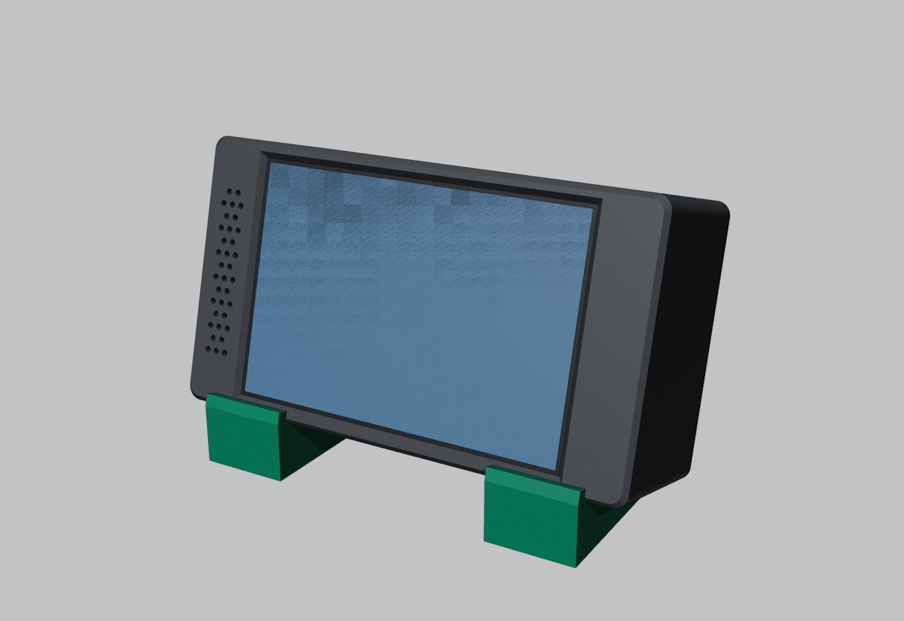
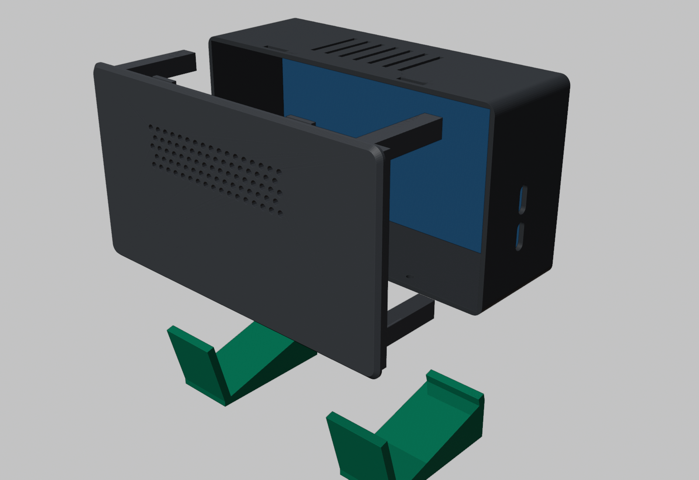
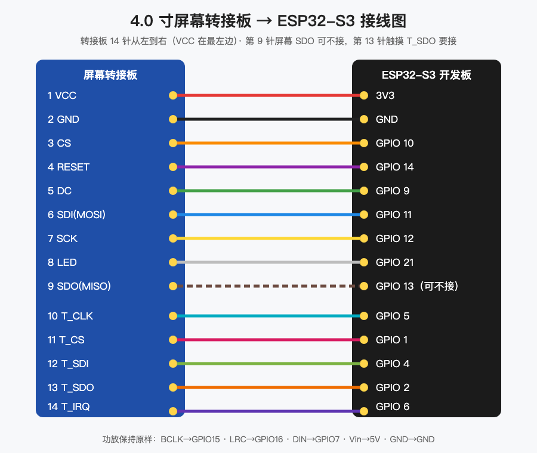

# 桌面拓竹看板（ESP32-S3 + 4 寸屏）



放在打印机旁边的一块横屏：

- 五页：两台拓竹打印机、Cursor 用量、天气、系统。没有触摸时每 30 秒自动翻页。
- 开始打印、完成、失败各有一段提示音，音量和亮度在系统页调节。
- 不用打开打印机的「仅局域网」，手机 App 继续能用。
- 外壳三件，免支撑。后盖顶部两个卡扣，底部两颗 M2×8 螺丝。
- 外形约 117 × 65 × 42 mm。

效果图是渲染图，界面截图来自实机网页预览。

本作品是个人 DIY，与拓竹实验室官方无关。

## 目录

```
拓竹看板/
├─ README.md                 ← 这篇
├─ MakerWorld简介.txt        ← 论坛标题和简介，复制去提交
├─ 01_3D打印文件/
│   ├─ 拓竹看板_外壳.3mf      ← 方向已摆好，直接切片
│   ├─ STL备用/
│   └─ 打印说明.md
├─ 02_固件/
│   ├─ esp32-dashboard/      ← PlatformIO 源码（不含密码）
│   └─ 刷机说明.md
├─ 03_接线图/
├─ 04_物料清单/
└─ 05_效果图/
```



## 准备材料

见 [`04_物料清单/物料清单.md`](04_物料清单/物料清单.md)。

主控是 **ESP32-S3-N16R8**，屏幕是 **4.0 寸 ST7796 SPI 转接板（电阻触摸）**，声音是 **MAX98357A** 加一只腔体喇叭。

## 3D 打印

见 [`01_3D打印文件/打印说明.md`](01_3D打印文件/打印说明.md)。

前壳正面朝下，后盖背面朝下，支架平放。0.20 mm，无支撑。工程板打 PLA 时先薄涂一层胶。

## 接线

见 [`03_接线图/接线说明.md`](03_接线图/接线说明.md)。



转接板第 13 针 **T_SDO 接到 GPIO 2**。这根不接的话，触摸会乱报。

## 刷固件

见 [`02_固件/刷机说明.md`](02_固件/刷机说明.md)。把 `secrets.example.h` 复制成 `secrets.h` 再填写，然后用 PlatformIO 上传。

## 装配

1. 屏幕玻璃朝前，转接板排针朝右，放进前壳。窗口对准发光区。
2. 开发板平放在底部，两个 Type-C 对准左侧两个竖孔，用泡棉胶粘住。
3. 喇叭贴在后盖出声孔后面。
4. 后盖顶部两个卡扣先挂进前壳，再压下去。
5. 从底部拧两颗 M2×8 自攻螺丝。螺丝头沉进去，支架不用开缺口。
6. 外壳放进两只支架，后仰大约 15°。

屏幕装反了、画面倒了，改 `LCD_ROTATION` 重新上传，不用拆壳。

## 使用

| 操作 | 说明 |
|---|---|
| 翻页 | 左右滑动。松开 30 秒后自动循环 |
| 提示音 | 打印开始、完成、失败。系统页可以试听 |
| 亮度 / 音量 | 系统页滑条，松手后记住 |
| 看屏幕内容 | 浏览器打开开发板 IP，或 `http://esp32dash.local/` |

## 常见问题

| 现象 | 处理 |
|---|---|
| 屏幕不亮 | 看 LED 是否接到 GPIO 21，VCC 是否接到 3V3 |
| 开机正常，过一会花屏 | 杜邦线太长，或 SCK 和电源捆在一起。线尽量短 |
| 触摸没反应 | 电阻屏要按实。检查 T_SDO 是否接到 GPIO 2 |
| 亮度自己变成很暗 | 多半是 T_SDO 没接，触摸在乱报。接上后再把系统页亮度调回去 |
| 打印机显示离线 | 看 IP 和访问码。不用开仅局域网 |
| 只有一台打印机 | 第二台的 `BAMBU2_*` 可以留空，那一页会显示离线 |

## 开源组件

- [LovyanGFX](https://github.com/lovyan03/LovyanGFX)
- [LVGL](https://lvgl.io/) 8.3
- [PubSubClient](https://github.com/knolleary/pubsubclient)
- [ArduinoJson](https://arduinojson.org/)
- 天气数据来自 [Open-Meteo](https://open-meteo.com/)
